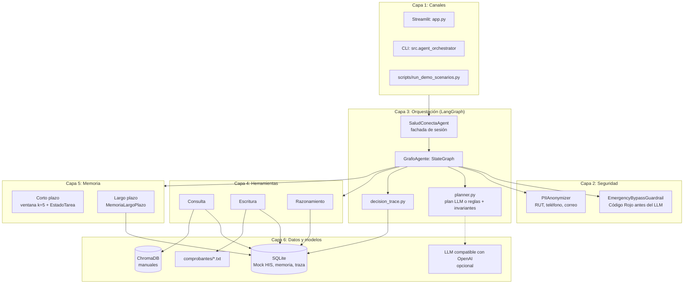
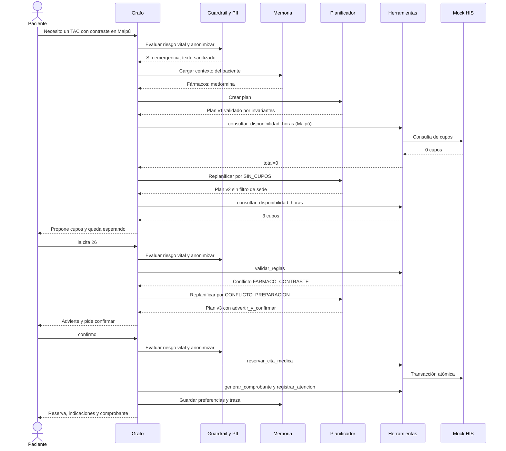
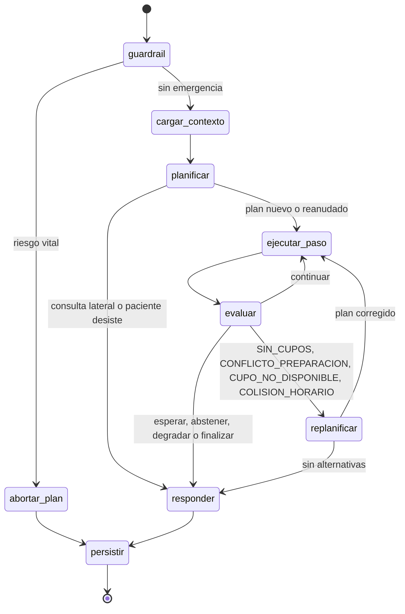
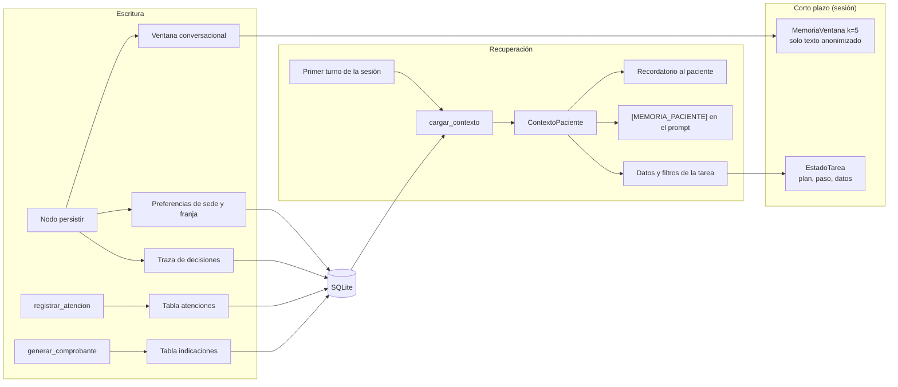

# Arquitectura del agente SaludConecta (EP2)

Todos los diagramas describen el código actual. El grafo de la sección 3 corresponde a `GrafoAgente._construir` en `src/agent_graph.py`.

## 1. Arquitectura por capas

### Herramientas por categoría

| Categoría | Herramienta | Módulo | Función |
|---|---|---|---|
| Consulta | `buscar_protocolo_rag` | `src/tools/consulta.py` | Preparación y convenios en los manuales, con umbral |
| Consulta | `consultar_catalogo_especialidad` | `src/tools/consulta.py` | Prerrequisito clínico de una especialidad |
| Consulta | `consultar_disponibilidad_horas` | `src/tools/consulta.py` | Cupos por especialidad, sede, fecha y franja |
| Consulta | `consultar_historial_paciente` | `src/tools/consulta.py` | Citas, atenciones, indicaciones y preferencias |
| Escritura | `reservar_cita_medica` | `src/tools/escritura.py` | Reserva atómica |
| Escritura | `cancelar_cita_medica` | `src/tools/escritura.py` | Cancelación con verificación del titular |
| Escritura | `reprogramar_cita` | `src/tools/escritura.py` | Traslado de cupo en una sola transacción |
| Escritura | `registrar_atencion` | `src/tools/escritura.py` | Resumen de la atención en el HIS |
| Escritura | `generar_comprobante` | `src/tools/escritura.py` | Archivo `.txt` sin RUT ni teléfono, más registro de indicaciones |
| Razonamiento | `clasificar_solicitud` | `src/tools/razonamiento.py` | Intención, especialidad, protocolo y ESI preliminar |
| Razonamiento | `validar_reglas` | `src/tools/razonamiento.py` | Cupo vigente, colisión horaria, fármacos, alergias y ayuno |
| Razonamiento | `seleccionar_siguiente_accion` | `src/tools/razonamiento.py` | Política determinista de la siguiente acción |

Cada herramienta tiene esquema de entrada y salida en `src/tools/schemas.py`. El decorador de `src/tools/base.py` aporta logging, reintentos ante fallas de BD y errores tipados.

## 2. Secuencia de un flujo completo

Agendamiento de TAC con contraste para un paciente en tratamiento con metformina, sin cupos en la sede pedida.

## 3. Grafo del planificador

Cada turno recorre el grafo desde `guardrail`. El estado entre turnos vive en la sesión (`EstadoTarea`), de modo que un plan en espera siempre vuelve a pasar por el Código Rojo.

### Disparadores de replanificación

| Motivo | Origen | Cambio en el plan |
|---|---|---|
| `SIN_CUPOS` | `total_cupos == 0` | Quita la franja y luego la sede. Sin filtros, deriva a Mesa Central |
| `CONFLICTO_PREPARACION` | `validar_reglas` con conflictos | Inserta `advertir_y_confirmar` antes de escribir |
| `CUPO_NO_DISPONIBLE` | Cupo tomado por otro paciente | Descarta el cupo y la confirmación; busca de nuevo |
| `COLISION_HORARIO` | El paciente ya tiene otra cita a esa hora | Igual que el anterior |

Fuera de la replanificación, `abstener` cierra el plan sin LLM y `degradar` entrega un mensaje controlado.

### Invariantes del plan

`asegurar_invariantes` en `src/planner.py` se aplica a todo plan, venga del LLM o de las reglas:

1. Solo herramientas registradas o pasos internos conocidos.
2. Sin RUT, nombre ni teléfono en los argumentos.
3. Toda reserva o reprogramación va precedida de `solicitar_datos` y `validar_reglas`.
4. Toda cancelación va precedida de `solicitar_datos`.
5. Una consulta de preparación siempre pasa por `buscar_protocolo_rag`.
6. La intención declarada debe tener su paso clave, y `elegir_cupo` exige una búsqueda previa.
7. El plan del LLM debe concordar con la intención reconocida por las reglas (`_concuerda_con_reglas`). Si las reglas no reconocen la solicitud, el LLM puede proponer lecturas o una búsqueda de cupos, pero nunca cancelar, reprogramar ni reservar un cupo directo.

Un plan que no se puede corregir se descarta y se usa el plan por reglas. Los argumentos de cada herramienta los resuelve el ejecutor desde el estado de la tarea: los que proponga el LLM se ignoran.

## 4. Flujo de memoria

| Dato | Dónde se guarda | Vigencia | Llega al LLM |
|---|---|---|---|
| Conversación anonimizada | `MemoriaVentana` | Sesión, últimos 5 turnos | Sí |
| Plan y datos recolectados | `EstadoTarea` | Hasta cerrar la tarea | RUT, teléfono y nombre conocido: no |
| Fármacos, alergias y prerrequisitos | Tablas `pacientes` e `indicaciones` | Entre sesiones | Fármacos y alergias: sí |
| Sede y franja preferidas | Tabla `preferencias` | Entre sesiones | Sí |
| Atenciones previas | Tabla `atenciones` | Entre sesiones | Sí, resumidas |
| RUT y teléfono | Tablas `pacientes` y `citas` | Entre sesiones | No |

Una cita se considera pendiente si está `RESERVADA`. No se compara con el reloj porque el Mock HIS es un calendario simulado.
