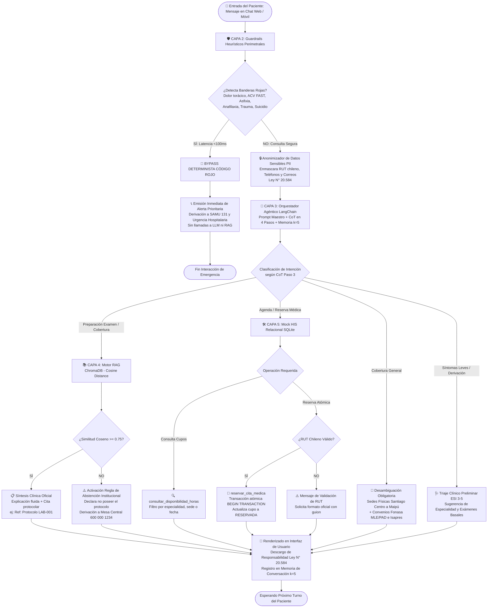

# 📐 Bocetos de Diseño, Arquitectura de Información y Experiencia de Usuario (UX)
## Red de Salud Metropolitana "SaludConecta"

> **Asignatura:** ISY0101 – Ingeniería de Soluciones con Inteligencia Artificial  
> **Evaluación Parcial N°1 (EP1):** Encargo Escrito y Repositorio Digital (Ponderación 30%). Actualizado en EP2: ver sección 6.  
> **Resultado de Aprendizaje (RA):** RA1 – Diseña soluciones basadas en modelos de lenguaje (LLM), aplicando técnicas de Prompt Engineering y RAG, que resuelvan requerimientos de información complejos en entornos organizacionales.  
> **Alumno:** Matias Alejandro Araos Urra  
> **Institución:** Duoc UC – Escuela de Informática y Telecomunicaciones  
> **Fecha:** Septiembre 2026  

---

## 1. Introducción y Propósito del Documento

El presente documento especifica el diseño de interacción, la arquitectura de información y la experiencia de usuario (UX/UI) del **Sistema Agéntico SaludConecta**. Dado que el sistema atiende consultas de salud que van desde trámites administrativos y preparación de exámenes hasta emergencias médicas con riesgo vital, el diseño prioriza la **seguridad del paciente**, la **claridad cognitiva** bajo estrés y el cumplimiento estricto de la **Ley N° 20.584** (Derechos y Deberes de los Pacientes en Chile).

---

## 2. Diagrama de Flujo de Decisión y Triaje Clínico

El siguiente diagrama detalla la ruta crítica de procesamiento que sigue cada mensaje del paciente, desde la capa perimetral de seguridad determinista hasta la entrega de la respuesta final.

### 2.1 Flujo Integral de Procesamiento (Mermaid)



---

## 3. Wireframes Textuales y Bocetos de la Interfaz (UI/UX)

A continuación se presentan los wireframes detallados en formato ASCII de los componentes visuales clave implementados en la aplicación web (`app.py`).

### 3.1 Wireframe 1: Interfaz Principal de Chat Asistencial (Web Desktop / Responsive)

```text
+----------------------------------------------------------------------------------------------------+
| 🏥 Red SaludConecta | Sistema de Triaje Inteligente y Agendamiento HIS            Mesa: 600 000 1234|
+----------------------------------------------------------------------------------------------------+
| SIDEBAR DE CONTROL              | ÁREA PRINCIPAL DE CONVERSACIÓN                                   |
|---------------------------------|------------------------------------------------------------------|
| 🏥 Red SaludConecta             | +--------------------------------------------------------------+ |
| Sede Central Metropolitana      | | 🏥 SaludConecta - Asistente Clínico Inteligente              | |
|                                 | | Orientación fáctica de exámenes y agendamiento integrado HIS | |
| [!] ALERTA RIESGO VITAL         | +--------------------------------------------------------------+ |
| Ante dolor de pecho opresivo,   |                                                                  |
| asfixia o sospecha de ACV:      | [🩺 SaludBot] 10:15 AM                                            |
| LLAME AL SAMU 131               | ¡Hola! Bienvenido a la Red SaludConecta. Soy SaludBot, tu        |
|                                 | asistente de orientación asistencial y triaje preliminar.        |
| ------------------------------- | ¿En qué te puedo orientar hoy?                                   |
| ⚡ CASOS DE PRUEBA RÁPIDA       | • Preparación de Exámenes (LAB, TAC, Resonancias)                |
| [🧪 1. Ayuno LAB-001 (RAG)    ] | • Especialidades y Prerrequisitos Clínicos                       |
| [🚨 2. Código Rojo (SAMU 131) ] | • Consulta y Reserva de Horas Médicas (Mock HIS)                 |
| [📍 3. Sedes Santiago Centro  ] | • Coberturas Fonasa e Isapres                                    |
| [⚠️ 4. Abstención Fuera Dominio]|                                                                  |
|                                 | [👤 Paciente] 10:16 AM                                            |
| ------------------------------- | ¿Cuáles son las indicaciones de ayuno para perfil lipídico?      |
| 🔄 [ Reiniciar Conversación   ] |                                                                  |
|                                 | [🩺 SaludBot] 10:16 AM                                            |
| ------------------------------- | ⏱️ Latencia: 1.20 ms  • 🛠️ HIS Tools: ninguno  • 🔒 PII: Seguro     |
| 📘 Proyecto Duoc UC - ISY0101   | Para su examen de Perfil Lipídico y Glicemia en Sangre:          |
| Alumno: Matias Araos Urra       | • Mantenga un ayuno estricto de 8 a 12 horas.                    |
| Evaluación Parcial N°1 (30%)    | • Prohibido café, té, leche o chicle.                            |
|                                 | • Autorizado hasta 250 ml de agua pura sin gas si tiene sed.     |
|                                 |                                                                  |
|                                 | [Ref: Protocolo LAB-001]                                         |
|                                 | *Descargo Institucional Ley 20.584: Información orientativa.*    |
|                                 |------------------------------------------------------------------|
|                                 | [ Escriba su consulta médica, de preparación o agendamiento... ] |
|                                 | [ Enviar > ]                                                     |
+----------------------------------------------------------------------------------------------------+
```

---

### 3.2 Wireframe 2: Banner Crítico de Código Rojo (Riesgo Vital ESI 1 y 2)

Este componente se renderiza inmediatamente cuando el `EmergencyBypassGuardrail` detecta patrones de riesgo vital en menos de 100 ms, interrumpiendo cualquier diálogo rutinario.

```text
+----------------------------------------------------------------------------------------------------+
| 🚨 ALERTA DE CÓDIGO ROJO - RIESGO VITAL DETECTADO (LATENCIA: 0.85 ms)                              |
+----------------------------------------------------------------------------------------------------+
|                                                                                                    |
|  ⚠️ ATENCIÓN MÉDICA INMEDIATA REQUERIDA                                                            |
|                                                                                                    |
|  Su mensaje describe síntomas que corresponden a una EMERGENCIA MÉDICA CON RIESGO VITAL:          |
|  -> Síntoma detectado: DOLOR_TORACICO_CORONARIO / SOSPECHA DE INFARTO AGUDO AL MIOCARDIO           |
|                                                                                                    |
|  ================================================================================================  |
|  📞 LLAME DE INMEDIATO AL SAMU MARCANDO EL 131 (LLAMADA GRATUITA DESDE CUALQUIER TELÉFONO)         |
|  ================================================================================================  |
|                                                                                                    |
|  INSTRUCCIONES DE ACTUACIÓN INMEDIATA:                                                             |
|  1. NO conduzca ni intente trasladarse por sus propios medios sin auxilio médico.                 |
|  2. Si está acompañado, avise a quien esté cerca para que permanezca a su lado.                   |
|  3. Adopte una posición de reposo absoluto semisentado (apoyado en almohadas o sillón).           |
|  4. Afloje prendas ajustadas (cuello, cinturón) y mantenga la calma mientras arriba el personal.  |
|                                                                                                    |
|  *Protocolo de Seguridad Institucional Red SaludConecta - Derivación Determinista Pre-LLM*        |
+----------------------------------------------------------------------------------------------------+
```

---

### 3.3 Wireframe 3: Tarjeta de Preparación de Exámenes Clínicos (Grounding RAG)

Presentación estructurada de indicaciones clínicas recuperadas del corpus oficial mediante RAG con similitud coseno $\ge 0.75$.

```text
+----------------------------------------------------------------------------------------------------+
| 📋 INDICACIONES DE PREPARACIÓN OFICIAL - RED SALUDCONECTA                                         |
| Procedimiento: Tomografía Computarizada (TAC) de Abdomen y Pelvis con Contraste Endovenoso        |
+----------------------------------------------------------------------------------------------------+
|                                                                                                    |
| 🕒 AYUNO Y ALIMENTACIÓN:                                                                           |
| • Ayuno de alimentos sólidos: 6 horas previas al examen.                                           |
| • Ingesta de líquidos: Se autoriza agua pura hasta 2 horas antes de la citación.                   |
|                                                                                                    |
| 🧪 PRERREQUISITOS DE LABORATORIO:                                                                  |
| • Examen de Creatinina en Sangre obligatorio (vigencia máxima: 30 días para evaluar función renal).|
| • Pacientes diabéticos en tratamiento con METFORMINA deben suspenderla 48 horas antes y después    |
|   del procedimiento, previa autorización de su médico tratante.                                    |
|                                                                                                    |
| ⚠️ PRECAUCIONES DE SEGURIDAD:                                                                      |
| • Antecedentes de alergia al yodo o medio de contraste requieren esquema de premedicación          |
|   antialérgica ambulatoria de 12 horas.                                                            |
|                                                                                                    |
| -------------------------------------------------------------------------------------------------- |
| 🏷️ Código Institucional: [Ref: Protocolo IMG-102]                                                  |
| ⚖️ Descargo Institucional: Red SaludConecta - Ley N° 20.584. Documento no sustituye indicación médica|
+----------------------------------------------------------------------------------------------------+
```

---

### 3.4 Wireframe 4: Modal y Confirmación Transaccional de Cita Médica (Mock HIS)

Flujo de consulta y confirmación de horas médicas sobre la base de datos relacional SQLite con prevención de colisiones.

```text
+----------------------------------------------------------------------------------------------------+
| 🩺 DISPONIBILIDAD DE HORAS MÉDICAS - MOCK HIS (SEDE SANTIAGO CENTRO)                               |
+----------------------------------------------------------------------------------------------------+
| Se encontraron 3 cupos disponibles en el sistema hospitalario:                                     |
|                                                                                                    |
| [ ] ID #1 | CARDIOLOGÍA ADULTO | Dr. Roberto Silva    | 2026-12-07 a las 09:00 hrs | Fonasa/Isapre|
| [ ] ID #2 | CARDIOLOGÍA ADULTO | Dr. Roberto Silva    | 2026-12-07 a las 10:00 hrs | Fonasa/Isapre|
| [X] ID #4 | TRAUMATOLOGÍA      | Dr. Carlos Henríquez | 2026-12-08 a las 11:00 hrs | Fonasa/Isapre|
+----------------------------------------------------------------------------------------------------+
| 📝 FORMULARIO DE CONFIRMACIÓN DE RESERVA ATÓMICA                                                   |
|----------------------------------------------------------------------------------------------------|
| Cupo Seleccionado : Cita ID #4 (Traumatología - Columna | Dr. Carlos Henríquez)                    |
| Sede de Atención  : Clínica Central (Av. Alameda 1234, Santiago Centro)                            |
|                                                                                                    |
| RUT del Paciente  : [ 15.678.901-2               ]  ✅ Formato chileno válido                      |
| Nombre Completo   : [ Juan Pablo Pérez González   ]                                                |
| Teléfono Móvil    : [ +56 9 8877 6655            ]                                                |
| Previsión Salud   : (•) Fonasa MLE    ( ) Isapre Convenio I-Med    ( ) Particular                  |
|                                                                                                    |
| [  CONFIRMAR RESERVA ATÓMICA  ]                 [  Cancelar  ]                                     |
+----------------------------------------------------------------------------------------------------+
|                                                                                                    |
| 🟢 RESULTADO EN TIEMPO REAL:                                                                       |
| ✅ RESERVA CONFIRMADA EXITOSAMENTE:                                                                |
| • Código de Reserva: #4                                                                            |
| • Profesional: Dr. Carlos Henríquez (Traumatología - Columna)                                      |
| • Fecha y Hora: 2026-12-08 a las 11:00 hrs                                                         |
| • Paciente: Juan Pablo Pérez González (RUT: 15.678.901-2)                                          |
| • Estado en Base de Datos: RESERVADA (Bloqueo atómico contra doble agendamiento)                   |
|                                                                                                    |
| 💡 Indicación: Presentarse 15 minutos antes con cédula de identidad y orden médica si corresponde. |
+----------------------------------------------------------------------------------------------------+
```

---

## 4. Arquitectura de Información (AI)

La arquitectura de información organiza las entidades de conocimiento y flujos funcionales del sistema en cuatro cuadrantes jerárquicos:

```text
                               ┌─────────────────────────────┐
                               │  RED DE SALUD SALUDCONECTA  │
                               └──────────────┬──────────────┘
                                              │
         ┌───────────────────┬────────────────┴──────────────────┬───────────────────┐
         ▼                   ▼                                   ▼                   ▼
┌─────────────────┐ ┌─────────────────┐                 ┌─────────────────┐ ┌─────────────────┐
│ 1. SEGURIDAD    │ │ 2. INFORMACIÓN  │                 │ 3. ESPECIALIDAD │ │ 4. SERVICIOS    │
│    CLÍNICA      │ │    PREPARACIÓN  │                 │    Y TRIAJE     │ │    AGENDA HIS   │
├─────────────────┤ ├─────────────────┤                 ├─────────────────┤ ├─────────────────┤
│ • Bypass Rojo   │ │ • Laboratorio   │                 │ • 45 Especialid.│ │ • Consulta Citas│
│   (ESI 1-2)     │ │   (LAB-001/002) │                 │ • Prerrequisitos│ │ • Reserva Atom. │
│ • SAMU 131      │ │ • Imagenología  │                 │ • Triaje ESI 3-5│ │ • Cancelación   │
│ • Anonimizador  │ │   (IMG-101..104)│                 │ • Desambiguación│ │ • Validación    │
│   PII (RUT/Tel) │ │ • Endoscopías   │                 │   de Cobertura  │ │   RUT Chileno   │
│ • Ley N° 20.584 │ │ • Convenios     │                 │   (Sedes/Conven)│ │ • Prevención de │
│                 │ │   (Fonasa/Isapr)│                 │                 │ │   Colisiones    │
└─────────────────┘ └─────────────────┘                 └─────────────────┘ └─────────────────┘
```

---

## 5. Experiencia de Usuario (UX) y Accesibilidad en Salud

### 5.1 Principios Heurísticos de Nielsen Aplicados a Salud Digital

1. **Visibilidad del Estado del Sistema:**
   - Cada interacción muestra telemetría explícita: latencia en milisegundos (`⏱️ Latencia: 1.20 ms`), herramientas de agenda invocadas (`🛠️ HIS Tools`) y estado de protección de privacidad (`🔒 PII Protegido`).
2. **Correspondencia entre el Sistema y el Mundo Real:**
   - Vocabulario adaptado al paciente chileno: uso de términos institucionalizados como *"Fonasa MLE"*, *"Bono PAD"*, *"I-Med por huella digital"*, *"RUT con dígito verificador"* y *"SAMU 131"*.
3. **Control y Libertad del Usuario:**
   - Botón visible y permanente de `🔄 Reiniciar Conversación` para limpiar el historial y la memoria deslizante ($k=5$).
   - Posibilidad de cancelar citas médicas previamente tomadas devolviendo el cupo al estado `DISPONIBLE`.
4. **Consistencia y Estándares:**
   - Formato consistente de respuestas clínicas: saludo empático -> cuerpo informativo -> código de protocolo oficial (`[Ref: Protocolo XXX]`) -> descargo de responsabilidad legal.
5. **Prevención de Errores Clínicos y Transaccionales:**
   - Validación sintáctica previa de RUT chileno (con o sin puntos, guion obligatorio y dígito verificador).
   - Bloqueo transaccional de SQLite (`BEGIN TRANSACTION` y condición `WHERE id = ? AND estado = 'DISPONIBLE'`) que impide la sobreventa o doble agendamiento concurrente de horas.
   - Activación de la **Regla de Oro de Abstención Fáctica** si el score de similitud no alcanza $0.75$, evitando que el paciente reciba indicaciones inventadas sobre procedimientos delicados.

### 5.2 Accesibilidad Web (WCAG 2.1 Nivel AA)

* **Paleta Cromática Accesible y Contraste:**
  - Colores corporativos basados en tonos médicos con alto contraste sobre fondo blanco:
    - Primario (Acción / Encabezados): `#0d9488` (Teal oscuro) y `#0369a1` (Azul médico). Ratio de contraste $\ge 4.8:1$.
    - Alerta Crítica (Código Rojo): Fondo `#fef2f2`, borde `#dc2626`, texto `#991b1b`. Ratio de contraste $\ge 7.1:1$ (cumple estándar AAA).
* **Legibilidad y Jerarquía Tipográfica:**
  - Tipografías legibles con tamaño mínimo de 16px en cuerpos de texto para facilitar la lectura a pacientes adultos mayores o con deficiencias visuales.
  - Uso de viñetas claras y espaciado interlineal amplio ($1.5$) en instrucciones de ayuno y medicamentos.
* **Diseño Responsivo Multi-Dispositivo:**
  - El layout de Streamlit se adapta dinámicamente a pantallas móviles (smartphones de pacientes en tránsito) y pantallas de escritorio (computadores de admisión y call center).
* **Consideraciones de Seguridad y Ética Médica (Ley N° 20.584):**
  - Protección de datos sensibles mediante anonimización automática previa al procesamiento.
  - Inclusión obligatoria del descargo: *"La orientación asistencial entregada por SaludBot es preliminar y no constituye diagnóstico médico ni prescripción farmacológica."*

---

## 6. Elementos de interfaz agregados en EP2

La barra lateral suma el selector de paciente y la memoria. Cada respuesta suma el panel de traza. Los botones de prueba de EP1 pasan a ser escenarios adaptativos, más un interruptor que simula la caída del HIS.

### 6.1 Wireframe 5: Barra lateral con memoria del paciente

```text
+---------------------------------+
| 👤 Paciente de la sesión        |
| Identificador simulado          |
| [ PAC-001 · Juan Pérez Soto  v] |
|                                 |
| v 🧠 Memoria del paciente       |
|   Fármacos: metformina          |
|   Alergias: sin registro        |
|   Preferencias: sede: Santiago  |
|   Centro, franja: mañana        |
|   📌 Cita #26: Imagenología -   |
|   TAC con Contraste,            |
|   2026-12-09 08:30              |
|   2026-11-06: Agendar una       |
|   atención (cita #26)           |
|                                 |
| ⚡ Escenarios Adaptativos       |
| [🔄 1. Sin cupos en la sede   ] |
| [🚨 2. Riesgo vital en el plan] |
| [⚠️ 3. Fuera de dominio       ] |
| [💊 4. TAC y metformina       ] |
| (o ) 🔌 5. Simular caída del HIS|
+---------------------------------+
```

Cambiar de paciente inicia una sesión nueva: limpia el corto plazo y carga la memoria persistente. Si hay citas pendientes, el primer mensaje del chat las recuerda con su preparación.

### 6.2 Wireframe 6: Panel de traza de decisiones

Cada respuesta del agente incluye un panel plegable. Muestra versión y estado del plan, y los eventos del turno.

```text
| 🩺 🔄 Sin cupos en Maipú: se amplía a otras sedes.                         |
|    🩺 Cupos disponibles:                                                   |
|    - ID 26 | Imagenología - TAC con Contraste con Dr. Tomás Riquelme ...   |
|                                                                            |
|    ⏱️ Latencia: 304.19 ms • 🛠️ HIS Tools: clasificar_solicitud, ...        |
|    v 🧭 Traza de decisiones · plan v2 (esperando_paciente)                 |
|      MEMORIA: Contexto cargado: 0 cita(s) pendiente(s) ...                 |
|      PLAN_INICIAL: Agendar una atención (origen: reglas)                   |
|      HERRAMIENTA consultar_disponibilidad_horas: ok=True error=None        |
|      DECISION consultar_disponibilidad_horas: replanificar: SIN_CUPOS      |
|      REPLAN consultar_disponibilidad_horas: sin cupos en Maipú ...         |
```

**Criterios de diseño:**

- La traza va plegada: es evidencia técnica y no debe distraer al paciente.
- Los chips muestran el tipo de dato protegido, nunca su valor.
- Solo el Código Rojo se pinta como emergencia. Las respuestas que mencionan el SAMU por otros motivos se muestran normales.
- La latencia del Código Rojo corresponde al guardrail. En los demás turnos corresponde al turno completo.
